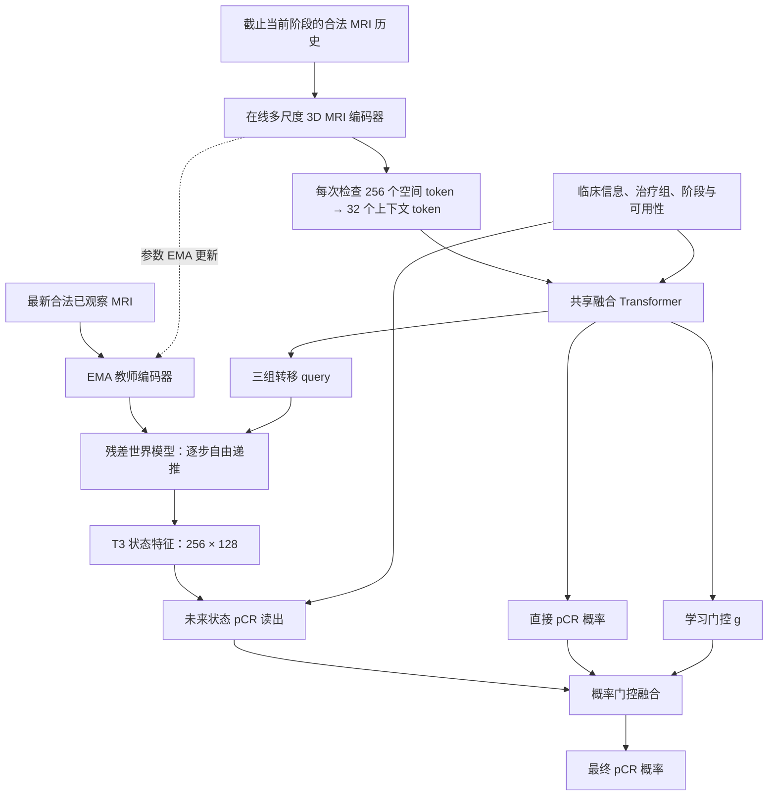

# 当前正式实验的网络结构

核对日期：2026-10-09。对象是 `runs/joint_three_seed_20261009` 的固定 T0 / 动态六个正式实验，种子为 17、43、71。六份配置的 `model` 和 `loss` 相同；固定和动态改变输入历史及采样，不改变网络拓扑。本文按实际 `model.py`、`objectives.py`、`engine.py` 和运行配置整理。

## 主预测路径

这是同一个模型内的两条 pCR 分支。自由递推的起点来自最新已观察 MRI 的教师特征，无反向梯度；后续预测可微。真实未来 MRI 只进入独立监督目标和 teacher-forcing 训练支路，不进入用于 pCR 分类的真实观测输入。

## 输入

- 单次检查是 `[3,32,128,128]`：三通道分别为对比前、首个增强相位、元数据指定的晚期增强相位。三通道是同次检查的 DCE 相位。
- 患者输入保留四个阶段槽位，形状 `[B,4,3,32,128,128]`；不可见槽位为零且被遮蔽，只编码当前阶段合法可用的 MRI。
- 四项临床信息为年龄、HR、HER2、MammaPrint。每项将数值与可用性标记共同投影到 128 维，再加字段嵌入，共四个临床 token。
- 治疗组使用 13 个类别加未知类别，并加入何时已知的嵌入，形成一个治疗 token。临床与治疗输入都按当前 sample 的已知时间遮蔽。

## MRI 编码器

`MultiScaleEncoder` 使用 3D 卷积和空间 Transformer；所有检查共享权重。

| 部分 | 输出形状，省略 batch |
|---|---|
| Conv3D stem：3→24，stride=(1,2,2) | `24×32×64×64` |
| Stage 0：两个残差块 | `24×32×64×64` |
| Stage 1：下采样，两个残差块 | `48×16×32×32` |
| Stage 2：下采样，两个残差块 | `96×8×16×16` |
| Stage 3：下采样，两个残差块 | `128×4×8×8` |

残差块为 depthwise 3D 卷积、GroupNorm、1×1×1 通道扩展、GELU、通道投影及残差连接。Stage 2/3 分别投影到 128 通道、池化到 `4×8×8` 网格，两级相加并除以 √2。展平成 256 个空间 token，加位置嵌入，经两层空间 Transformer 和 LayerNorm，输出 `[B_visit,256,128]`。

Transformer 使用 128 维、4 个注意力头、512 维 FFN、Pre-LN、GELU、dropout 0.1。上下文 AttentionPool 用 32 个可学习 query，将每次检查的空间 token 读成 `[B_visit,32,128]`；完整 256-token 网格仍用于世界状态。

## 共享融合主干

融合输入包括一个 root、四组 MRI 上下文槽位（4×32）、四个临床 token、一个治疗 token、三个未来转移 query 组（3×8）、四个 pCR query，总计 162 个槽位；未观察 MRI 的槽位使用 padding mask。

共享融合 Transformer 有两层。合法已观察上下文之间双向注意；转移和 pCR query 段使用按序注意力遮罩。输出三组 `[8,128]` 转移表示，以及四个 pCR query 的平均特征 `[B,128]`。后者经 LayerNorm+Linear 得到直接 pCR logit，同时用于计算融合门控。

`query_mask` 仅决定返回哪些未来状态，不参与 backbone、pCR 分类或损失选择。

## 世界模型与未来 pCR

世界模型为四层因果 Transformer，接收源状态空间 token、对应转移 query、空间位置和时间嵌入。每步预测残差变化：

`下一状态 = 源状态 + 预测变化`

变化投影在初始化时为零，因此初始化行为是复制源状态。所有预测步共享同一个世界模型。固定 T0 从 T0 教师状态依次预测 T1/T2/T3；动态从最新合法已观察检查出发，预测尚未观察的后续阶段。没有最新阶段之前的虚构观测；缺失中间检查可以保留。

未来 pCR 读出将 T3 状态的 256 个 token、五个条件 token、一个当前阶段 token（共 262）送入 AttentionPool，用四个 query 读取并平均，再经 LayerNorm+Linear 得到未来分支概率。若当前已经观察到 T3，终点是该次检查的教师状态，不再预测未来。

最终融合在概率空间进行：

`p_final = (1−g)·p_direct + g·p_forecast`

`g` 由共享 pCR 特征经 LayerNorm+Linear+sigmoid 产生；门控初始 bias=-2，未来分支初始权重约 11.9%。实际实现使用稳定的 log-space 计算。`forecast_detach=false`：未来分支及融合分类损失可反传到世界模型，并经转移表示反传到共享融合主干和在线编码器；教师编码器无反向梯度。

## ABC 联合训练

A/B/C 对应三类任务，共享网络。在同一批数据的一次反向传播中优化：

| 任务 | 实际路径与权重 |
|---|---|
| A 表征学习 | 最新合法检查遮蔽约 35% 空间块；在线编码器+两层 mask predictor 预测该次完整 MRI 的教师 latent。masked L1×1、pooled variance×1、covariance×0.04、token variance×0.1 |
| B 世界预测 | teacher-forcing latent L1×0.25，加自由多步 rollout latent L1×1；监督来自未来真实 MRI 的教师特征 |
| C pCR | 融合 BCE×1、直接 BCE×0.5、未来分支 BCE×0.25 |

`repr_projector` 的 MLP 为 128→256→128，用于方差与协方差正则。`repr_head` 在模型中存在，但当前 `repr_pcr=0`，没有启用其辅助分类损失；`align=0` 也未启用。固定 T0 的 A 支路仅用 T0；动态 A 支路用该 sample 最新合法检查。当前未开启随机翻转/强度增强，空间遮蔽仍存在。

从随机初始化开始，在线编码器、共享融合、世界模型及启用的辅助/分类读出一起优化。教师初始复制在线编码器，每次 AdamW 更新后以 0.996 的 EMA 系数更新。分类读出组学习率 1e-4，其余可训练参数为 3e-5；每个正式 run 的实际 batch=16、累积=1。

## 参数规模与核对范围

CPU 实例化六个正式 run 配置并检查模型配置一致，参数计数为：

| 范围 | 参数数 |
|---|---:|
| 完整模型，含教师和训练辅助模块 | 4,564,068 |
| 标记 requires_grad 的参数 | 3,364,020 |
| 在线 MRI 编码器 | 1,200,048 |
| EMA 教师编码器 | 1,200,048 |
| 世界模型 | 877,184 |

requires_grad 计数包含未启用的 `repr_head` 的 385 个参数，不能把全部标记可训练的参数理解为每批都收到梯度。上述核对是读取源码/正式配置和 CPU 模型实例化计数，没有启动新训练或修改网络。

源码依据：`src/response_jepa/model.py` 的 `MultiScaleEncoder`、`ResponseJEPA.backbone/rollout/forward`、`WorldPredictor`；`src/response_jepa/objectives.py` 的 `representation_loss/task_world_loss/joint_loss`；`src/response_jepa/engine.py` 的 `optimizer_for` 及统一 backward/AdamW/EMA 路径。
